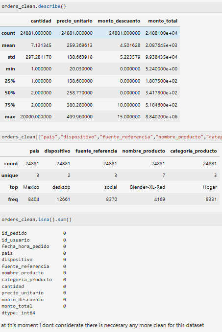
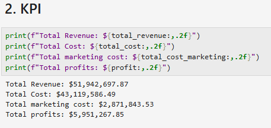
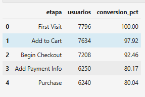
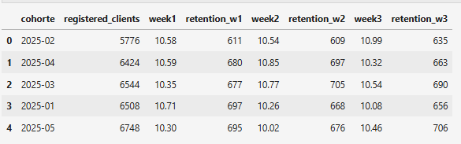
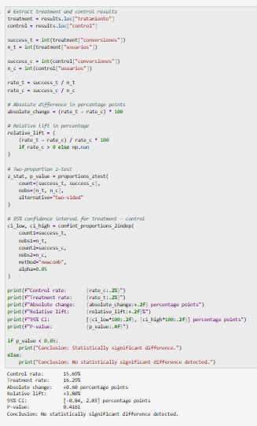

# 🛒 E-commerce Data Analytics: Sales, Retention & A/B Testing

## 📌 Project Overview

This project explores e-commerce data to evaluate sales performance, product profitability, customer behavior, retention, and the effectiveness of an A/B experiment.

Using **Python, SQL, and Tableau**, this project follows an end-to-end data analytics workflow, transforming raw datasets into actionable insights that support data-driven business decisions.

The main goal is to understand business performance, identify customer behavior patterns, and evaluate opportunities to improve conversion rates and profitability.

## 🎯 Project Objectives

- 🧹 Clean and prepare datasets to improve data quality.
- 💰 Analyze revenue, costs, profit, and sales performance.
- 🏆 Identify best-selling products based on units sold.
- 📊 Calculate business KPIs and profitability metrics.
- 🔄 Analyze the customer journey through a conversion funnel.
- 👥 Measure customer retention using monthly cohorts.
- 🧪 Evaluate an A/B experiment using statistical hypothesis testing.
- 📈 Develop an interactive Tableau dashboard to visualize business performance.

## 🛠️ Tools & Technologies

| Technology | Purpose |
|---|---|
| 🐍 Python | Data cleaning, transformation, EDA, and statistical analysis |
| 🐼 Pandas & NumPy | Data manipulation and numerical calculations |
| 📐 SciPy & Statsmodels | Statistical testing and confidence intervals |
| 🗄️ SQL | Funnel analysis, cohort analysis, and retention metrics |
| 📊 Tableau | KPI visualization and business intelligence dashboards |
| 🌐 Git & GitHub | Version control and project documentation |

## 🔍 1. Data Cleaning & Preparation

The first stage focused on inspecting datasets, identifying quality issues, and preparing reliable data for analysis.

### Key activities

- 🔎 Inspected data structures, data types, and missing values.
- 🧹 Identified and removed exact duplicate records, including 100 duplicate rows.
- ⚖️ Evaluated the impact of missing data before deciding whether to remove or preserve records.
- 🗑️ Removed records where quantity, unit price, and discount were all missing.
- 👤 Evaluated whether missing customer-country values could be inferred from other records.
- 📦 Removed records with missing product names or categories where these fields were required.
- 🏷️ Handled missing referral-source and marketing-channel values.
- ⚠️ Investigated negative quantities and their effect on order totals.

The objective was to improve data consistency while minimizing unnecessary data loss.

### 📸 Data Cleaning Results


## 📊 2. Exploratory Data Analysis & Business KPIs

After preparing the data, the analysis focused on understanding sales performance and product-level metrics.

### Key Performance Indicators

- 💵 **Total Revenue:** Sum of order revenue.
- 🧾 **Total Product Cost:** Product quantity multiplied by unit cost.
- 💰 **Total Profit:** Revenue minus product costs.
- 🏆 **Best-Selling Product:** Product with the highest total quantity sold.
- 📦 **Product Performance:** Comparison of product sales and revenue.

### Profit Calculation

The product catalog was combined with order data to incorporate unit costs into the profitability analysis.

**Business logic:**

`Profit = Total Revenue - Total Product Cost`

**Tableau calculated field:**

```tableau
SUM([Monto Total])
-
SUM([Costo Unitario] * [Cantidad])
```

Correct table relationships are essential to prevent duplicate records from inflating revenue or costs.

### 📸 Exploratory Data Analysis

<!-- Add a screenshot of your Python notebook showing KPI calculations or product rankings. -->



## 🗄️ 3. SQL Analysis

SQL was used to analyze customer behavior, conversion events, and retention patterns.

### 🔄 Conversion Funnel

The conversion funnel follows the customer journey through key e-commerce events:

1. 👀 First Visit
2. 🛒 Add to Cart
3. 🧾 Begin Checkout
4. 💳 Add Payment Information
5. ✅ Purchase

The analysis measures distinct users at each stage and calculates conversion rates relative to the initial funnel population.

**Key metrics:**
- Users reaching each stage.
- Conversion rate by stage.
- Potential customer drop-off points.

This analysis provides a framework for identifying opportunities to improve the customer journey.

### 📸 Conversion Funnel

<!-- Add a screenshot of the SQL query or the resulting funnel visualization. -->



### 👥 Cohort & Customer Retention Analysis

Users were grouped into monthly cohorts based on their registration dates. Retention was measured at defined intervals after registration.

**Metrics calculated:**

- 👤 Initial cohort size.
- 📅 Week 1 retained users.
- 📅 Week 2 retained users.
- 📅 Week 3 retained users.
- 📈 Weekly retention percentages.

**Retention formula:**

`Retention Rate = Retained Users / Initial Cohort Users × 100`

This analysis supports comparisons of customer engagement across registration cohorts.

### 📸 Cohort Retention Results

<!-- Add a screenshot of the SQL query or the monthly cohort retention output. -->



## 🧪 4. A/B Testing & Statistical Hypothesis Testing

The experiment compared a control group against a treatment group to determine whether the treatment produced a statistically significant difference in conversion rates.

### Statistical Methodology

- **H₀ — Null Hypothesis:** The control and treatment groups have equal conversion rates.
- **H₁ — Alternative Hypothesis:** The control and treatment groups have different conversion rates.
- **Statistical Test:** Two-proportion Z-test.
- **Significance Level:** α = 0.05.
- **Confidence Interval:** 95%.

### 📊 Experimental Results

| Metric | Result |
|---|---:|
| Control Conversion Rate | 15.69% |
| Treatment Conversion Rate | 16.29% |
| Absolute Change | +0.60 percentage points |
| Relative Lift | +3.80% |
| 95% Confidence Interval | -0.84 to +2.03 percentage points |
| P-value | 0.4161 |

### 💡 Interpretation

The treatment group achieved a slightly higher observed conversion rate, with a relative lift of 3.80%.

However, the p-value of **0.4161** is greater than the significance threshold of 0.05, and the 95% confidence interval includes zero.

Therefore, the experiment did not provide sufficient statistical evidence to conclude that the treatment significantly improved conversion rates.

The observed difference may be due to random variation. Further experimentation could help determine whether the treatment has a genuine business impact.

### 📸 A/B Testing Analysis

<!-- Add a screenshot of your Python statistical test and results. -->



## 📈 5. Tableau Dashboard
The final stage focused on presenting business metrics through an interactive, multi-view Tableau dashboard designed to support both high-level executive monitoring and granular product-level analysis.

### Dashboard Structure
The solution is split into two complementary views:
 - Overview Dashboard (Current State: January – June 2025):
   - High-Level KPIs: Instant visibility into Total Revenue ($51.9M), Total Profit ($5.95M), and Marketing Costs ($2.87M).
   - Geographic Breakdown: Sales volume and investment percentages distributed across Mexico, Argentina, and Colombia with consistent color-coding.
   - Financial Trajectory: Monthly gross profit trends tracking performance from January through June.
 - Detailed View (Category & Product Performance Breakdown):
   - Category Highlights: Identifies top-performing categories (e.g., Electronics driving $45.5M or 87.7% of total revenue).
   - Granular Profit Trends: Tracks gross profit performance by product category over time.
   - Product-Level Analysis: Detailed breakdown comparing units sold, profit, and revenue across individual items (e.g., Gaming Laptops, Appliances, and Apparel).

### 🖥️ Final Dashboard Preview

)

## 🔄 6. End-to-End Analytical Workflow

The project followed these steps:

1. 🔎 **Data Inspection:** Reviewed data structures, missing values, and duplicates.
2. 🧹 **Data Cleaning:** Evaluated incomplete records and data inconsistencies.
3. 🔗 **Data Integration:** Combined orders and catalog information for cost and profit calculations.
4. 📊 **Exploratory Analysis:** Calculated revenue, costs, profit, and product sales metrics.
5. 🗄️ **SQL Analytics:** Developed conversion funnel and cohort retention queries.
6. 🧪 **Statistical Testing:** Evaluated conversion differences using a two-proportion Z-test.
7. 📈 **Data Visualization:** Built a Tableau dashboard for business performance analysis.
8. 📝 **Documentation:** Recorded methodologies, results, and analytical conclusions.

## 🏁 7. Key Findings

- 💰 Combining order and catalog data enables product-level profitability analysis.
- 🏆 Quantity-based rankings help identify the products with the highest sales volume.
- 🔄 Funnel analysis provides a structured method for investigating customer journey drop-offs.
- 👥 Cohort analysis helps evaluate retention across registration months.
- 🧪 The A/B experiment showed an observed relative conversion lift of 3.80%, but the difference was not statistically significant at the 5% level.

These results demonstrate the value of combining descriptive analytics, customer behavior analysis, and statistical testing.

## 🎓 8. Skills Demonstrated

- Data cleaning and preparation.
- Exploratory data analysis (EDA).
- SQL aggregations, joins, and common table expressions (CTEs).
- Business KPI development.
- Sales and profitability analysis.
- Conversion funnel analysis.
- Cohort and retention analysis.
- Statistical hypothesis testing.
- A/B experiment evaluation.
- Tableau dashboard development.
- Analytical communication and documentation.

## 🏷️ Tags

`Data Analytics` `E-commerce` `Python` `Pandas` `NumPy` `SQL` `Tableau` `EDA` `Data Cleaning` `KPI Analysis` `Sales Analytics` `Profitability` `Conversion Funnel` `Cohort Analysis` `Customer Retention` `A/B Testing` `Statistical Analysis` `Data Visualization` `Business Intelligence`

---

⭐ **If you find this project interesting, feel free to explore the repository and review the analytical workflow.**
